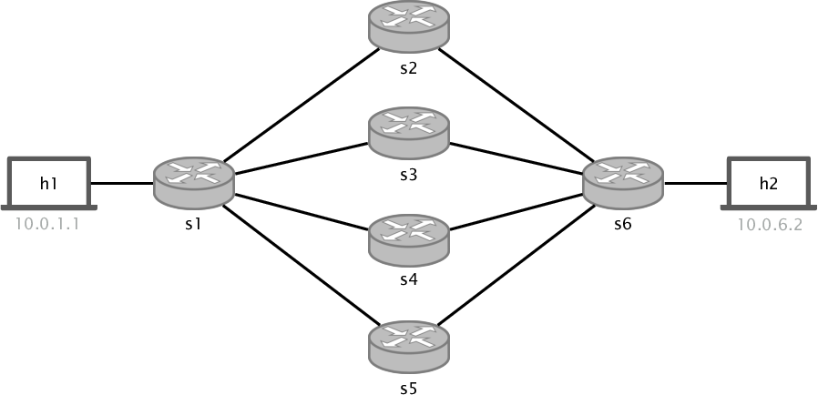

# 等价多路径路由

**中文** | [English](README.en.md)

## 介绍

本练习将实现一个三层转发交换机，使其能够通过多条等价路径，对发往同一目的地的流量进行负载均衡。为实现多端口之间的流量负载均衡，我们将使用等价多路径（ECMP，Equal-Cost Multi-Path）路由。当具有多条候选路径的数据包到达时，交换机应对报头中的部分字段进行哈希计算，再对可用等价路径的数量取模，以此确定下一跳。例如，在下方拓扑中，当 `s1` 需要向 `h2` 发送数据包时，应通过计算 `hash(some-header-fields) mod 4` 来确定输出端口。为避免数据包乱序，ECMP 按流进行哈希，因此具有相同源和目的 IP 地址、相同源和目的端口的数据包始终会被哈希到同一个下一跳。

<p align="center">

<p/>

更多 ECMP 信息请参阅此[页面](https://docs.cumulusnetworks.com/display/DOCS/Equal+Cost+Multipath+Load+Sharing+-+Hardware+ECMP)。

## 开始之前

与往常一样，本练习提供以下文件：

* `p4app.json`：描述我们借助 mininet 和 p4-utils 包创建的拓扑。
* `p4src/ecmp.p4`：作为实现起点的 P4 程序框架。
* `p4src/includes`：本练习首次将 P4 代码拆分到多个文件中。includes 目录中包含 `headers.p4` 和 `parsers.p4`，这两个文件也需要补全。
* `send.py`：用于生成多个具有不同 TCP 端口的数据包的小型 Python 脚本。

> **原文说明：** 原文在此使用 `p4src/includes`，而后文及仓库实际目录使用 `p4src/include`。保留原路径名称供对照。

#### 关于 p4app.json 的说明

本练习及下一个练习将采用新的 IP 分配策略。查看 `p4app.json` 可以看到，该选项设为 `mixed`。因此，只有连接到同一交换机的主机才会被分配到同一子网；连接到不同交换机的主机属于不同的 `/24` 子网。如果采用 `hX` 和 `sX` 的命名方式（例如 h1、h2、s1 等），IP 地址的分配格式为 `10.x.x.y`，其中 `x` 表示交换机编号的高、低字节，`y` 表示主机编号。例如，在上述拓扑中，`h1` 获得 `10.0.1.1`，`h2` 获得 `10.0.6.2`。

关于 `p4app.json` 的完整说明可以在 `p4-utils` [文档](https://github.com/nsg-ethz/p4-utils#topology-description)中找到。

## 实现三层转发交换机与 ECMP

完成本练习需要对交换机进行编程，使其能够在存在一个或多个可用下一跳时转发三层数据包。为此，我们使用两个流表：第一个流表匹配目的 IP 地址，并根据该目的地址是否需要使用 ECMP，设置输出端口或 ecmp_group。对于后者，应用第二个流表，将 (ecmp_group, hash_output) 映射到出口端口。

本次需要补全多个文件：`p4src/ecmp.p4`、`p4src/include/headers.p4` 和 `p4src/include/parsers.p4`。此外，还需要为每个交换机创建一个 `cli` 命令文件，命名为 `sX-commands.txt`（参见 `p4app.json`）。

完成本练习需要执行以下步骤：

1. 使用已经提供的报头定义。

2. 定义能够解析到 `tcp` 报头的解析器。为简化练习，本次不考虑 `udp` 数据包。解析器应定义在 `p4src/include/parsers.p4` 中。

3. 定义反解析器，按正确顺序输出所有报头即可。

4. 定义一个匹配每个数据包 IP 目的地址的匹配-动作流表，包含三个动作：`set_nhop`、`ecmp_group`、`drop`。将丢弃动作设为默认动作。

5. 定义 `set_nhop` 动作。该动作接收 2 个参数：目的 MAC 地址和出口端口。使用这些参数设置目的 MAC 地址和 `egress_spec`。将源 MAC 地址设为原来的目的 MAC 地址（真实的三层交换机不会这样处理，这里仅为简化实现）。在更贴近实际的实现中，我们会创建一个将出口端口映射到各交换机接口 MAC 地址的流表；但由于本练习对源 MAC 地址要求不高，直接进行上述替换即可。从一个交换机向另一个交换机发送数据包时，目的地址并不十分重要，因此可以使用随机地址。但需要注意，发往主机的数据包必须具有正确的目的 MAC 地址。最后，将数据包的 TTL 减 1。**注意：** 由于这是三层网络，从 `s1` 向 `s2` 发送数据包时，应使用交换机接口的目的 MAC 地址，而不是接收主机的 MAC 地址；接收主机的 MAC 地址只在最后一跳使用。最后，将数据包的 TTL 减 1。

   > **原文说明：** 原文在此重复了 TTL 减 1 的指令；当前 `set_nhop` 实现只执行一次减 1。原文同时给出了交换机间目的 MAC 地址可随机选择与应使用接口地址的不同表述，均保留供对照。

6. 定义 `ecmp_group` 动作。该动作接收两个参数：ECMP 组编号（14 位）和下一跳数量（16 位）。这是 ECMP 算法的关键动作之一，需要完成以下工作：

   1. 在该动作中计算哈希值。为存储输出，需要定义元数据字段：在 `headers.p4` 的元数据结构体中定义 `ecmp_hash`（14 位）。使用 `hash` 外部函数对数据包五元组（源 IP、目的 IP、源端口、目的端口、协议）进行哈希计算。哈希函数签名为：
   `hash(output_field, (crc16 or crc32), (bit<1>)0, {fields to hash}, (bit<16>)modulo)`。
   2. 定义另一个元数据字段，命名为 `ecmp_group_id`（14 位）。
   3. 最后，将第二个动作参数 ecmp group 的值复制到刚定义的元数据字段（`ecmp_group_id`）中，用于第二个流表的匹配。

   > **原文说明：** 上述第 3 小步将组编号称为“第二个动作参数”，但前文参数列表与当前 `ecmp_group(bit<14> ecmp_group_id, bit<16> num_nhops)` 定义中，组编号是第一个参数，下一跳数量才是第二个参数。此处保留原表述。

**注意：** 许多人问过为什么需要 `ecmp_group_id`。简而言之，它可以将一个 IP 地址映射到一组端口，这组端口不一定是本练习使用的全部 4 个端口。例如，`IP1` 可以只使用上方 2 个端口，`IP2` 则使用下方 2 个端口进行负载均衡。因此，通过创建两个 ECMP 组，就可以方便地将任意目的地址映射到任意端口集合。

7. 定义第二个匹配-动作流表，将 `ecmp_groups` 映射到实际下一跳。该流表应对上一步定义的元数据字段进行 `exact` 匹配，即匹配 `meta.ecmp_group_id` 和哈希函数输出 `meta.ecmp_hash`（其取值范围为 0 到 `NUM_NEXT_HOPS-1`）。匹配成功时调用前面定义的 `set_nhop` 动作；未匹配时，将数据包标记为丢弃（将 `drop` 设为默认动作）。这样可以使用任意接口子集。例如，假设上述拓扑中存在 `h2` 和 `h3`（实际没有 h3，这里仅用于举例），可以在前一个流表中定义两个不同的 `ecmp` 组：一组映射到端口 2 和 4，另一组映射到端口 3 和 5。然后在本流表中为每组添加两条规则，将哈希函数的输出 `[0,1]` 分别映射到 [2,4] 和 `[3,5]`。

8. 定义入口控制逻辑：

   1. 检查 ipv4 报头是否已解析（使用 `isValid`）。
   2. 应用第一个流表。
   3. 如果应用第一个流表时调用了 `ecmp_group` 动作，则调用第二个流表。

   注意：要确定应用流表时调用了哪个动作，可以使用 switch 语句和 `action_run`。更多关于检查已执行动作的信息，参见 [P4 16 规范](https://p4.org/p4-spec/docs/P4-16-v1.0.0-spec.html#sec-invoke-mau)。

9. 本练习首次修改数据包字段（即将 ip.ttl 字段减 1）。修改后必须更新 `ipv4` 校验和字段，否则其他网络设备或接收主机可能会丢弃数据包。为此，`v1model` 提供了一个 `extern` 函数，可在 `MyComputeChecksum` 控制块中调用以更新校验和字段。本练习无需自行修改这一部分，但请查看 `ecmp.p4` 文件中 `update_checksum` 的用法。

10. 本次需要编写六个 `sX-commands.txt` 文件，每个交换机对应一个。只有 `s1` 和 `s6` 需要安装 `ecmp` 组；对于其余交换机，只需使用 `set_nhop` 动作为第一个流表设置规则。对 `s1`，需要设置一个直接通向 `h1` 的下一跳，以及一个通向 `h2` 的 ECMP 组。将 ECMP 组设为 `id = 1`、`num_hops = 4`，再通过第二个流表定义 4 条规则，将 0 到 3 分别映射到 4 个交换机输出端口之一。

## 测试实现

完成 `ecmp.p4` 程序及所有 `commands.txt` 文件后，可以测试其行为：

1. 启动拓扑（这一步也会编译并加载程序）。

   ```bash
   sudo p4run
   ```

2. 检查是否可以 ping：

   ```bash
   > mininet pingall
   ```

3. 监控 `s1` 中用于 `ecmp` 的 4 条链路（从 `s1-eth2` 到 `s1-eth5`），以检查每条流经过哪条路径。

   ```bash
   sudo tcpdump -enn -i s1-ethX
   ```

4. 在两台主机之间执行 ping：

   应当只在 1 或 2 个接口上看到流量（考虑返回路径），因为所有 ping 数据包具有相同的五元组。

5. 在两台主机之间运行 iperf：

   同样应当只在 1 或 2 个接口上看到流量（考虑返回路径）。同一条流中的所有数据包具有相同的五元组，因此哈希函数始终返回相同的索引。

6. 在 `h1` 中打开终端，使用 `send.py` 脚本。

   ```bash
   python send.py 10.0.6.2 1000
   ```

   该脚本发送具有随机端口的 `tcp syn` 数据包。此时应当能看到数据包经过所有接口，因为每个数据包会得到不同的哈希值。

#### 调试与故障排查说明

原教程在文档部分提供了一份简短的调试与故障排查指南，用于在运行结果不符合预期时参考（原链接不可用：当前仓库未包含 `documentation/debugging-and-troubleshooting.md`）。
